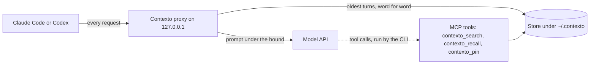

# Contexto

[](https://github.com/VentureForgre/contexto/actions/workflows/ci.yml) [](LICENSE) 

Contexto is a local proxy that keeps Claude Code and Codex requests under a fixed token bound by
moving the oldest turns to disk, word for word, and giving the model tools to search them back.

- **A fixed bound.** Each turn starts with the request under the bound, 150,000 tokens by default,
  however long the session runs. The turns removed to make room stay on disk word for word, not as
  a summary. A very long tool loop or an oversized prompt can still pass it ([limitations](#known-limitations)).
- **Recall no worse than full context on a scripted recall test.** On claude-haiku-5-5, Contexto
  answered 52 of 54 questions; the same model given the whole history of about 426,000 tokens
  answered 47. That is one synthetic session and one seed, and the gap is inside noise (p = 0.18).
  On claude-opus-5-5 it was 53 against 54 ([results](docs/results.md)).
- **Fewer input tokens sent**: 46.6% fewer in one measured session, against a partly modeled plain
  Claude Code. Cost depends on the model and on cache hits: 49.7% less at Haiku 5.5's prices. At
  flat prices such as Opus 5.5's it is more if plain Claude Code hits the prompt cache on every
  request, and less with the two cache misses the full-context run had ([results](docs/results.md#tokens-and-cost)).

## Install

Needs Python 3.12 or later on macOS or Linux, and `claude` (Claude Code) or `codex` on `PATH`.

```sh
pipx install https://github.com/VentureForgre/contexto/releases/download/v0.5.24/contexto-0.5.24-py3-none-any.whl
```

Contexto is not on PyPI: `pip install contexto` installs an unrelated project. Checking the
download before you install, other ways to install, and uninstalling: [docs/install.md](docs/install.md).

## Quickstart

```sh
contexto run claude
contexto run --bound 120000 claude --model claude-haiku-5-5
```

Contexto options go before `claude`. Everything after `claude` is passed to Claude Code unchanged.
Your Claude Code settings, hooks and MCP servers still load, and nothing in your Claude
configuration is edited. Every option: [docs/run-reference.md](docs/run-reference.md). Resuming,
`/clear` and `/compact`: [docs/claude-code.md](docs/claude-code.md). Codex runs through `contexto run codex`
in API-key mode and needs a key helper, a command that prints your API key ([docs/codex.md](docs/codex.md)).


A synthetic session: a stub CLI and a fake upstream on `127.0.0.1`, no model, with one token counted
per 3.5 bytes. `contexto`, its proxy, store and search are the real code ([transcript](docs/assets/demo.txt)).
The small bound, `--headroom-floor`, `--no-version-check` and `--upstream` are there only for the
stand-ins. The request shrinks at a history of about 50,000 because Contexto moves old turns out
before the next request could reach the bound.

## Who it is for

You run Claude Code or Codex sessions that grow far past the bound, you want the old turns kept
word for word, and your upstream is the vendor's API with an API key or a CLIProxyAPI instance
([docs/cliproxyapi.md](docs/cliproxyapi.md)). It is not for:

- **A claude.ai subscription login.** Running Contexto on a Pro or Max login is not a supported
  setup. `contexto run claude` on a machine logged in that way sends the subscription's traffic
  through a third-party local proxy that rewrites requests. Whether your plan allows that is for
  you to check against its terms, and the risk to the account is yours ([FAQ](docs/faq.md)).
- **Sessions that stay under the CLI's own compaction point**, about 967,000 tokens by default on a
  1M-window model. They do not compact, with or without Contexto ([comparison](#why-not-compaction-a-1m-window-or-the-memory-tool)).
- **Work that needs every old detail in view at once.** The model sees a paged-out turn only when
  it runs a search for it.
- **Windows.** It is not supported.

## How it works

`contexto run claude` starts a proxy on `127.0.0.1` and points Claude Code at it. Every model
request passes through the proxy, which keeps the prompt sent upstream under the **bound**: the most
tokens Contexto lets a request's prompt reach, 150,000 by default.



The proxy keeps some **headroom** free below the bound for the conversation to grow into: 25,000
tokens by default, raised after large turns, up to a quarter of the bound. When a request gets
within the headroom of the bound, the proxy **rotates**: it moves the oldest turns out of the prompt
and writes them, word for word, to a local store under `~/.contexto`. Those turns are now **paged
out**. In their place the model sees the **page index**, which holds the opening of each paged-out
turn, and the **pinned state**: the decisions, obligations and facts the model recorded with the
`contexto_pin` tool. The room left for conversation turns is the **window budget**: the bound, minus
the headroom floor, minus the fixed overhead of every request (the CLI's system prompt and tool
definitions).

The model reads paged-out turns back with MCP tools: `contexto_search` finds turns by the words they
contain, and `contexto_recall` returns one in full. The proxy rotates only at the start of a turn,
never inside a tool loop. It makes no model calls of its own.

<picture>
  <source media="(prefers-color-scheme: dark)" srcset="docs/assets/request-size-dark.svg">
  
</picture>

Largest request in each turn of acceptance run 3 (Claude Code 2.1.301, claude-haiku-5-5, bound
150,000), one scripted session. Contexto's request sizes are measured. The full-history line is
modeled from the byte sizes of Claude Code's requests for turns 1 to 18 and measured for the six
question turns ([record](docs/research/M2-usage-savings-run3.md)). Haiku 5.5 has a 1M-token window,
so plain Claude Code would not have compacted at 438,406.

## Why not compaction, a 1M window or the memory tool?

Often one of them is enough. The facts about Claude Code below are from its docs on 2026-11-12:
[models](https://code.claude.com/docs/en/model-config), [context window](https://code.claude.com/docs/en/context-window), [idle compaction](https://code.claude.com/docs/en/settings-reference#idlecompaction) and [memory](https://code.claude.com/docs/en/memory).

**A 1M window.** Fable models, Sonnet 5 and later, Haiku 5.5, and Opus 4.7 and later run with a
1M-token window by default and auto-compact at about 967,000 tokens. On the Anthropic API the 1M
window has no premium beyond 200K, except on Haiku 5.5, which costs more on prompts over 100K. So a
session that ends before about 967,000 tokens does not compact, with or without Contexto, and the
426,000-token test history above would not have. One exception: by default Claude Code compacts a
conversation of 200,000 tokens or more that sits idle for about an hour on the one-hour prompt
cache. If your sessions fit, you do not need Contexto. What Contexto changes is the size of each
request, which stays under the bound where a 1M window carries the whole history every time.

**Compaction** "replaces the conversation with a structured summary". After it, the project-root
CLAUDE.md and auto memory are re-injected from disk and up to five recently modified files are
re-read. Path-scoped rules and nested CLAUDE.md files are summarized away with the rest until they
load again. `/compact focus on ...` steers the summary, and `/autocompact 500k` sets the point, from
100K to 1M. If a summary of the old turns is enough, compaction needs no searches and no proxy.
Contexto keeps the removed turns word for word, and pays for it: the model sees them only through
a search it must choose to run, each search is another request, and each rotation rewrites the
prompt cache.

**Memory.** Claude Code's memory is CLAUDE.md files, which hold instructions you write, and auto
memory, notes Claude writes for itself from your corrections and preferences. Both load at the start
of every session. They hold what someone chose to save, across sessions. Contexto holds every
paged-out turn of one session word for word, and nothing across sessions. It edits neither.

## What you see

**When it is working.** At start Contexto prints one line on stderr that begins `contexto: session`
and names the bound, and `/mcp` in Claude Code lists the `contexto` server as connected. Nothing
else shows until the prompt nears the bound, about 125,000 tokens with the defaults. After the first
rotation, `contexto sessions list` shows a PAGES count above 0, and `contexto sessions show <id>`
should count 0 over-bound turns ([Is it working?](docs/sessions.md#is-it-working)).

**What it adds.** The proxy adds time to each request, more as the history grows: 0.056 s per turn
start and 0.014 s per tool-loop request at 0.5 million tokens of history, 0.099 s and 0.044 s at 2
million, 0.86 s and 0.58 s at 30 million (medians of 3 runs, synthetic sessions, local fake
upstream; [record](docs/research/M2-scale-30m.md)). Recall adds model round trips, since each search
is one more request: in acceptance run 3 the six question turns took 26 requests, against 6 without.

**When it fails.** Warnings raised while Claude Code runs are printed after it exits.

- Upstream unreachable: the proxy answers 502 `contexto proxy: upstream unreachable (...)` and the
  CLI's own retry takes over.
- Store unreadable or unwritable: Contexto stops paging. Requests grow past the bound and are logged
  `over_bound` until the store is healthy again at a later turn start.
- No Contexto tools in the model's tool list: a `warning:` line says so. The model then cannot get
  paged-out turns back.
- The proxy runs inside `contexto run` and stops only when that process does. SIGTERM, SIGHUP and
  SIGQUIT are forwarded to Claude Code. After a SIGKILL a watchdog ends Claude Code (within 2 s
  when measured) and removes the temporary files. The store stays, and
  `contexto run claude --resume <id>` continues the conversation.

## Privacy

- The proxy listens on `127.0.0.1` only and answers only the local CLI. It forwards requests to the
  upstream you configured. No telemetry, no update check, no model calls of its own, and no runtime
  dependencies.
- The store under `~/.contexto` holds raw conversation text, including any secrets that passed
  through the conversation. Directories are mode 0700 and files 0600. Auth headers and keys are
  never stored. Contexto deletes nothing on its own ([What is stored](docs/sessions.md#what-is-stored-and-where)).
- Besides paging the prompt, the one thing Contexto adds to requests is an `X-Session-Affinity`
  header, and only for upstreams that are not a vendor API ([FAQ](docs/faq.md)).

## Known limitations

- **Tool loops.** Contexto never rotates inside a tool loop. A turn that grows past the bound inside
  one very long tool loop is sent as is and logged `over_bound`. The next turn start rotates. A
  single prompt too large for the bound also goes over, logged `bound_too_small`.
- **Tested scope.** Recall was measured with one synthetic session script, on two models, at one
  bound, on Claude Code 2.1.301, 2.1.302 and 2.1.318. Codex passed the long-session checks on one
  model; its accuracy against a full-context baseline was not measured.
- **Cost and time.** Fewer tokens is not always less money: each rotation rewrites the prompt cache
  and each search is another request ([results](docs/results.md#tokens-and-cost)). Latency grows
  with the history ([What you see](#what-you-see)).
- **Standing rules** survive paging only if they open their message or the model pinned them. That
  was measured on one model and 8 rules ([Rules you give once](docs/standing-rules.md)).
- **Images and PDFs.** A paged-out image comes back from recall as `[image omitted]`. PDFs are
  counted high, 4,568 tokens a page, so a large PDF can page out the earlier conversation.
- **New CLI versions** come out every week and can change the text Contexto recognises in their
  requests. Until a version is tested, the launch warns ([CLI updates](docs/cli-updates.md)).
- **Search** matches words, not meaning: it finds turns that hold every word of the query ([MCP tools](docs/mcp-tools.md)).
- **Windows** is not supported.
- The full list is in [docs/limitations.md](docs/limitations.md).

## How it is built

Contexto has one maintainer, who directs AI coding agents. Builder agents write each change, and two
reviewer agents check every pull request before it merges; the "Reviewer A verdict" comments on pull
requests come from that process ([docs/maintainer-process.md](docs/maintainer-process.md)).

## Documentation

The index of everything under `docs/` is [docs/README.md](docs/README.md). The main guides:

- Setup: [Install](docs/install.md), [Claude Code](docs/claude-code.md), [Codex](docs/codex.md),
  [CLIProxyAPI](docs/cliproxyapi.md) and the [`contexto run` reference](docs/run-reference.md).
- Use: [Sessions](docs/sessions.md), [MCP tools](docs/mcp-tools.md),
  [Rules you give once](docs/standing-rules.md), [FAQ](docs/faq.md) and [Exit codes](docs/exit-codes.md).
- Evidence and history: [Results](docs/results.md), [Known limitations](docs/limitations.md),
  [CLI updates](docs/cli-updates.md) and the [changelog](CHANGELOG.md).

## Troubleshooting

The warnings and errors you are most likely to see, each with its cause and what to do, are in
[docs/troubleshooting.md](docs/troubleshooting.md). A message that says "see README, 'contexto run'"
means [docs/run-reference.md](docs/run-reference.md#contexto-run).

## Contributing and security

Development, tests and releases: [CONTRIBUTING.md](CONTRIBUTING.md). Reporting a vulnerability:
[SECURITY.md](SECURITY.md). Bugs and new CLI versions: [issues](https://github.com/VentureForgre/contexto/issues).

## License

MIT. See [LICENSE](LICENSE).
