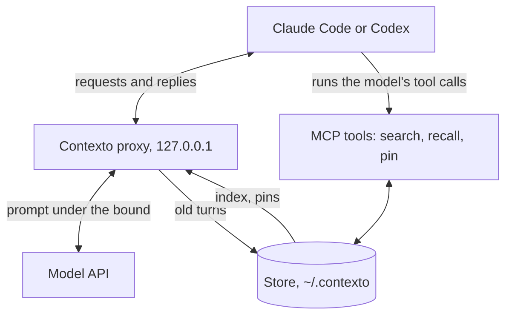
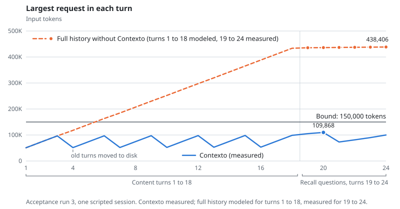

# Contexto

[](https://github.com/VentureForgre/contexto/actions/workflows/ci.yml) [](LICENSE) 

Contexto is a local proxy that keeps Claude Code and Codex requests under a fixed token bound by
moving the oldest turns to disk, word for word, and giving the model tools to search them back.

- **A fixed bound.** Each turn starts with the request under the bound, 150,000 tokens by default,
  however long the session runs. The turns removed to make room stay on disk word for word, not as
  a summary. On `main` this holds inside a long tool loop too (the requests the CLI sends while
  the model calls tools, before it answers you; [in-turn paging](docs/in-turn-paging.md)). A
  request can still pass it, for example in a Codex tool loop, on v0.5.24 in any tool loop, with
  in-turn paging switched off, in a loop with nothing left to page, with very dense tool output at a
  tight bound, or with an oversized prompt ([limitations](#known-limitations)).
- **Recall no worse than full context on a scripted recall test.** In a scripted synthetic
  session (acceptance run 4) on claude-haiku-5-5, Contexto answered 52 of 54 recall questions. The
  same model given the whole history of about 426,000 tokens answered 47. That is one session and
  one seed, and the gap is inside noise (p = 0.18). In a separate run on claude-opus-5-5, Contexto
  answered 53 of 54 and full context 54, one question behind and inside the test's pass rule:
  within 2 questions overall and no question category more than 1 question below
  ([results](docs/results.md)).
- **Fewer input tokens, not always less money.** In an earlier scripted session (acceptance run 3),
  Contexto sent 46.6% fewer input tokens than plain Claude Code would have; the plain figures are
  modeled from measured requests. At Haiku 5.5's prices, which are 5 times higher on a prompt over
  100,000 tokens, Contexto cost 49.7% less. At flat prices such as Opus 5.5's, Contexto would cost
  66% more if plain Claude Code read its prompt cache on every request, and less given the two cache
  misses the measured plain requests had ([results](docs/results.md#tokens-and-cost)).

Plain Claude Code compacting on its own was not run in these sessions. `contexto bench` runs
Contexto, full context and plain Claude Code set to compact at the same bound (at its defaults,
Claude Code on a 1M-token window would compact near 967,000 tokens, so not at all in this session)
on the same generated session for seeds you choose, with your own key; its replay needs no key
([benchmark](docs/bench.md)). It is on `main` and not yet in a release (releases are cut by hand and
batched under D67): from a checkout, run `uv run contexto bench --replay`. No live run of
`contexto bench` has been made yet.

## Install

On macOS or Linux, Contexto needs Python 3.12 or later, pipx, `claude` (Claude Code) or `codex` on
`PATH`, and either an Anthropic API key or a [CLIProxyAPI](docs/cliproxyapi.md) upstream (a
separate local or hosted proxy in front of the vendor APIs). A claude.ai Pro or Max login is not a
supported setup, Contexto does not detect one, and the risk to the account is yours
([who it is not for](#who-it-is-for)).

```sh
pipx install \
  https://github.com/VentureForgre/contexto/releases/download/v0.5.24/contexto-0.5.24-py3-none-any.whl
```

Contexto is not on PyPI yet: `pip install contexto` installs an unrelated project, and the name
it will be published under, `contexto-proxy`, has no release there. Checking the
download before you install, other ways to install, and uninstalling: [docs/install.md](docs/install.md).

## Quickstart

```sh
contexto run claude
contexto run --bound 120000 claude --model claude-haiku-5-5
```



A synthetic session: a stub CLI and a fake upstream on `127.0.0.1`, no model, with one token counted
per 3.5 bytes. `contexto`, its proxy, store and search are the real code ([transcript](docs/assets/demo.txt)).
The small bound, `--headroom-floor` (the least room kept free under the bound), `--upstream` (the
fake upstream) and `--no-version-check` (skip the check of the stub's version) are there only for
the stand-ins. The request shrinks at a history of about 50,000 tokens because Contexto moves old
turns out before the next request could reach the bound.

Contexto options go before `claude`. Everything after `claude` is passed to Claude Code unchanged.
Your Claude Code settings, hooks and MCP servers still load, and nothing in your Claude
configuration is edited. Every option: [docs/run-reference.md](docs/run-reference.md). Resuming,
`/clear` and `/compact`: [docs/claude-code.md](docs/claude-code.md). Codex runs through
`contexto run codex` in API-key mode and needs a key helper, a command that prints your API key
([docs/codex.md](docs/codex.md)).

## Who it is for

It is for you if either holds:

- Your Claude Code or Codex sessions pass the CLI's own compaction point (about 967,000 tokens on a
  1M-window model), and you want the old turns kept word for word, not summarized.
- You want every request kept small, for example under Haiku 5.5's price step at 100,000 tokens.

Your upstream must be the vendor's API with an API key, or a CLIProxyAPI instance
([docs/cliproxyapi.md](docs/cliproxyapi.md)). It is not for:

- **A claude.ai Pro or Max login.** That is not a supported setup, and Contexto does not detect it.
  `/status` in Claude Code shows which account it uses. If it is a subscription, `contexto run
  claude` sends that subscription's traffic through a third-party local proxy that rewrites
  requests. The [FAQ](docs/faq.md) describes logging a subscription in to CLIProxyAPI instead.
  Whether your plan allows either route is for you to check against its terms, and the risk to the
  account is yours.
- **Claude Code set to a cloud provider** (Amazon Bedrock, Google Vertex AI, Microsoft Foundry or
  Claude Platform on AWS). Claude Code then sends its requests to that provider, not through
  Contexto, so nothing is bounded. The v0.5.24 release installed above does not check for this and
  starts a session anyway; a build from the unreleased code on `main` refuses to
  start the session.
- **Sessions that end before the compaction point, when a large request is fine for you.** They do
  not compact, with or without Contexto. The exception: by default Claude Code compacts a
  conversation of 200,000 tokens or more after it sits idle for about an hour on the one-hour
  prompt cache ([comparison](#why-not-compaction-a-1m-window-or-the-memory-tool)).
- **Work that needs every old detail in view at once.** The model sees a paged-out turn only when
  it runs a search for it.
- **Windows.** It is not supported.

## How it works

`contexto run claude` starts a proxy on `127.0.0.1` and points Claude Code at it. Every model
request passes through the proxy, which keeps the prompt sent upstream under the **bound**: the most
tokens Contexto lets a request's prompt reach, 150,000 by default.



The proxy keeps some **headroom** free below the bound for the conversation to grow into: at least
the headroom floor, 25,000 tokens by default, raised after large turns, up to a quarter of the
bound. When a request gets
within the headroom of the bound, the proxy **rotates**: it moves the oldest turns out of the prompt
and writes them, word for word, to a local store under `~/.contexto`. Those turns are now **paged
out**. In their place the model sees the **page index**, which holds the opening of each paged-out
turn, and the **pinned state**: the decisions, obligations and facts the model recorded with the
`contexto_pin` tool. The room left for conversation turns is the **window budget**: the bound, minus
the headroom (at least the floor), minus the fixed overhead of every request (the CLI's system prompt and tool
definitions, the turns Contexto carries forward, the page index and the pinned state).

The model reads paged-out turns back with MCP tools: `contexto_search` finds turns by the words they
contain, and `contexto_recall` returns one word for word, in parts if it is long. The proxy rotates
only at the start of a turn. Inside a Claude Code tool loop, the code on `main` replaces older tool
results with short stubs and stores the originals ([in-turn paging](docs/in-turn-paging.md)). It
makes no model calls of its own.

<picture>
  <source media="(prefers-color-scheme: dark)" srcset="docs/assets/request-size-dark.svg">
  
</picture>

Largest request in each turn of acceptance run 3 (Claude Code 2.1.301, claude-haiku-5-5, bound
150,000), one scripted session. Contexto's request sizes are measured. The full-history line is
modeled from the byte sizes of Claude Code's requests for turns 1 to 18 and measured for the six
question turns ([record](docs/research/M2-usage-savings-run3.md)). Haiku 5.5 has a 1M-token window,
so plain Claude Code would not have compacted at 438,406.

## Why not compaction, a 1M window or the memory tool?

Often one of them is enough. The facts about Claude Code below are from its docs on 2026-11-12:
[models](https://code.claude.com/docs/en/model-config), [context window](https://code.claude.com/docs/en/context-window), [idle compaction](https://code.claude.com/docs/en/settings-reference#idlecompaction) and [memory](https://code.claude.com/docs/en/memory).

**A 1M window.** Fable models, Sonnet 5 and later, Haiku 5.5, and Opus 4.7 and later run with a
1M-token window by default and auto-compact at about 967,000 tokens. On the Anthropic API the 1M
window has no premium beyond 200K, except on Haiku 5.5, which costs more on prompts over 100K. So a
session that ends before about 967,000 tokens does not compact, with or without Contexto, and the
426,000-token history of the recall test (acceptance run 4) would not have. One exception: by default Claude Code compacts a
conversation of 200,000 tokens or more that sits idle for about an hour on the one-hour prompt
cache. If your sessions fit, you do not need Contexto. What Contexto changes is the size of each
request, which stays under the bound where a 1M window carries the whole history every time. That
is worth it in the cases under [Who it is for](#who-it-is-for).

**Compaction** "replaces the conversation with a structured summary". After it, most startup
content reloads (the system prompt, the project-root CLAUDE.md, unscoped rules, auto memory,
skills) and up to five recently modified files are re-read. Path-scoped rules and nested CLAUDE.md
files are summarized away with the conversation until they load again. `/compact focus on ...`
steers the summary, and `/autocompact 500k` sets the point, from 100K to 1M. If a summary of the old turns is enough, compaction needs no searches and no proxy.
Contexto keeps the removed turns word for word, and pays for it: the model sees them only through
a search it must choose to run, each search is another request, and each rotation rewrites the
prompt cache.

**Memory.** Claude Code's memory is CLAUDE.md files, which hold instructions you write, and auto
memory, notes Claude writes for itself from your corrections and preferences. Both load at the start
of every session. The API's [memory tool](https://platform.claude.com/docs/en/agents-and-tools/tool-use/memory-tool)
lets the model write files under `/memories` that your application stores and that later
conversations read back. All three hold what someone chose to save, across sessions. Contexto holds
every paged-out turn of one session word for word, and nothing across sessions. It edits none of
those files.

## What you see

**When it is working.** At start Contexto prints one line on stderr that begins `contexto: session`
and names the bound (in a project with earlier sessions, a `contexto: project memory:` line
follows), and `/mcp` in Claude Code lists the `contexto` server as connected. Claude
Code's status line shows `ctx bound 150k`, then the prompt against the bound after each reply
(`ctx 61k/150k`), unless you have a status line of your own ([Status line](docs/statusline.md)). Paging starts when the prompt nears the bound, from
about 113,000 to 125,000 tokens with the defaults. After the first rotation, `contexto sessions list` shows a PAGES count above 0, and
`contexto sessions show <id>` should count 0 over-bound turns ([Is it working?](docs/sessions.md#is-it-working)).
When Claude Code exits, Contexto prints a short summary of the run; `contexto stats` shows the whole
session ([Stats](docs/stats.md)), and `contexto doctor` checks the setup with no network request
([Doctor](docs/doctor.md)).

**What it adds.** The proxy adds time to each request, more as the history grows:

| History | Per turn start | Per tool-loop request |
|---|---|---|
| 0.5 million tokens | 0.056 s | 0.014 s |
| 2 million tokens | 0.099 s | 0.044 s |
| 30 million tokens | 0.86 s | 0.58 s |

Medians of 3 runs of synthetic sessions against a local fake upstream, measured on v0.2.7 code on
2026-10-17 ([record](docs/research/M2-scale-30m.md)). Recall adds model round trips, since each
search is one more request: in acceptance run 3 the six question turns took 26 requests, against 6
without.

**When it fails.** Warnings raised while Claude Code runs are printed after it exits.

- Upstream unreachable: the proxy answers 502 `contexto proxy: upstream unreachable (...)` and the
  CLI's own retry takes over.
- Store unreadable or unwritable: Contexto stops paging. Requests grow past the bound and are logged
  `over_bound` until the store is healthy again at a later turn start.
- No Contexto tools in the model's tool list: a `warning:` line says so. The model then cannot get
  paged-out turns back.
- Under `contexto run`, the proxy runs inside it and stops only when it does. SIGTERM, SIGHUP and
  SIGQUIT go on to Claude Code; after a SIGKILL a watchdog ends Claude Code (within 2 s when measured). The
  store stays, and `contexto run claude --resume <id>` continues the conversation.

## Privacy

- The proxy listens on `127.0.0.1` only: under `contexto run` on a free port for the CLI it starts,
  and under `contexto serve` on a fixed port (7837 by default), where every request must carry the
  token kept in `~/.contexto/serve.token` (mode 0600) ([The token](docs/serve.md#the-token)). It
  forwards requests to the upstream you configured. No telemetry, no update check, no model calls of
  its own, and no runtime dependencies.
- The store under `~/.contexto` holds raw conversation text, including any secrets that passed
  through the conversation. Directories are mode 0700 and files 0600. Upstream auth headers and keys are
  never stored. Contexto deletes nothing on its own ([What is stored](docs/sessions.md#what-is-stored-and-where)).
- Besides paging the prompt, the one thing Contexto adds to requests by default is an `X-Session-Affinity`
  header, and only for upstreams that are not a vendor API ([FAQ](docs/faq.md)).

## Known limitations

The full list, with sources, is in [docs/limitations.md](docs/limitations.md).

- **Tool loops.** On `main`, Contexto pages inside a Claude Code tool loop
  ([in-turn paging](docs/in-turn-paging.md)); whether an account that enforces preserved thinking
  accepts that has not been checked live. Codex tool loops, and every tool loop on v0.5.24, are sent
  whole, so a very long one can pass the bound (logged `over_bound`); the next turn start rotates.
  On `main` a Claude Code loop can still pass it with paging off (`--no-in-turn-paging`), when
  nothing is left to page (`in_turn_exhausted`), or at a tight bound with tool output denser than
  1.5 bytes a token (50 KB results reached 64,184 of 60,000 in review).
  A turn start can also pass it: a prompt too
  large for the bound (`bound_too_small`), a failing store, or a low estimate before the first count.
- **Tested scope.** Recall was measured with one synthetic session script, on two models, at one
  bound, on Claude Code 2.1.301, 2.1.302 and 2.1.318. Codex passed the long-session checks on one
  model; its accuracy against a full-context baseline was not measured.
- **Standing rules** survive paging only if they open their message or the model pinned them. That
  was measured on one model and 8 rules ([Rules you give once](docs/standing-rules.md)).
- **Images and PDFs.** A paged-out image comes back from recall as `[image omitted]`. PDFs are
  counted high, 4,568 tokens a page, so a large PDF can page out the earlier conversation.
- **New CLI versions** come out every week and can change the text Contexto recognises in their
  requests. Until a version is tested, the launch warns ([CLI updates](docs/cli-updates.md)).
- **Search** matches words, not meaning, with no synonyms and no stemming beyond one-letter typos.
  It lists the turns that hold every word of the query; when none does, the unreleased code on
  `main` (not v0.5.24) falls back to approximate matches ([Search](docs/search.md), [MCP tools](docs/mcp-tools.md)).

## How it is built

Contexto has one maintainer, who directs AI coding agents. Builder agents write each change, and two
reviewer agents check every pull request before it merges; the "Reviewer A verdict" comments on pull
requests come from that process ([docs/maintainer-process.md](docs/maintainer-process.md)).

## Documentation

[docs/README.md](docs/README.md) indexes everything under `docs/`. Setup: [Install](docs/install.md),
[Claude Code](docs/claude-code.md), [Codex](docs/codex.md), [CLIProxyAPI](docs/cliproxyapi.md),
[`contexto run`](docs/run-reference.md), [`contexto serve`](docs/serve.md) (IDE extensions, the Agent
SDK, CI). Use: [Sessions](docs/sessions.md), [MCP tools](docs/mcp-tools.md), [Search](docs/search.md),
[Rules you give once](docs/standing-rules.md), [Project memory](docs/project-memory.md),
[Stats](docs/stats.md), [Status line](docs/statusline.md), [Doctor](docs/doctor.md),
[Log events](docs/events.md), [FAQ](docs/faq.md), [Exit codes](docs/exit-codes.md).
Evidence: [Results](docs/results.md), [Benchmark](docs/bench.md), [Limitations](docs/limitations.md),
[CLI updates](docs/cli-updates.md),
[changelog](CHANGELOG.md).

## Troubleshooting

The warnings and errors you are most likely to see, each with its cause and what to do, are in
[docs/troubleshooting.md](docs/troubleshooting.md). A message that says "see README, 'contexto run'"
means [docs/run-reference.md](docs/run-reference.md#contexto-run).

## Contributing and security

Development, tests and releases: [CONTRIBUTING.md](CONTRIBUTING.md). Reporting a vulnerability:
[SECURITY.md](SECURITY.md). Bugs and new CLI versions: [issues](https://github.com/VentureForgre/contexto/issues).

## License

MIT. See [LICENSE](LICENSE).
