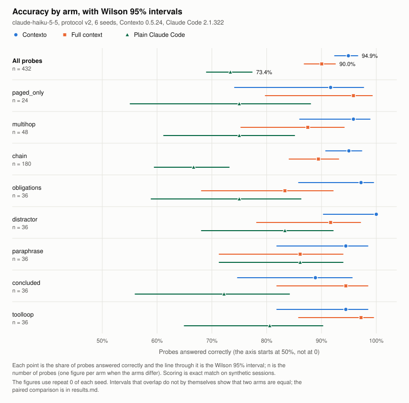
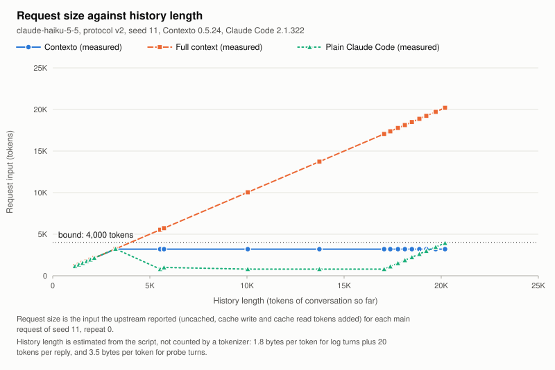

# Contexto benchmark results

Written by `contexto bench` from the records in the output directory: `manifest.json`, `probes.jsonl` and `requests.jsonl`. `contexto bench --report DIR` recomputes it.

## What was run

- A live run of `contexto bench`: protocol v2, bound 4,000 tokens, content turns of 2,000 bytes.
- Model: claude-haiku-5-5. Upstream: a local address (127.0.0.1): a stub standing in for a model.
- Versions: Contexto 0.5.24, Claude Code 2.1.322.
- Seeds: 11, 12, 13, 14, 15, 16 (6 seeds). The first seed was run 3 times to measure run-to-run noise.
- Arms: Contexto, full context, plain Claude Code.
- Started 2026-11-12T10:00:00Z, finished 2026-11-12T12:00:00Z.
- Units (one arm on one seed, once): 24 recorded, 24 complete, 0 stopped, 0 not run.
- The tables below use repeat 0 of each seed, so the repeated seed is counted once. The other repeats are used only for run-to-run noise.

## Accuracy by arm

Probes answered correctly, with the Wilson 95% interval. A session is one arm on one seed.

| Arm | Sessions | Probes | Correct | Accuracy | 95% interval | Stale answers |
| --- | --- | --- | --- | --- | --- | --- |
| Contexto | 6 | 432 | 410 | 94.9% | 92.4% to 96.6% | 0 |
| Full context | 6 | 432 | 389 | 90.0% | 86.9% to 92.5% | 0 |
| Plain Claude Code | 6 | 432 | 317 | 73.4% | 69.0% to 77.3% | 0 |

### Accuracy by probe class

Each cell is correct of asked, with the accuracy and its Wilson 95% interval.

| Class | Contexto | Full context | Plain Claude Code |
| --- | --- | --- | --- |
| paged_only | 22 of 24 (91.7%, 74.2% to 97.7%) | 23 of 24 (95.8%, 79.8% to 99.3%) | 18 of 24 (75.0%, 55.1% to 88.0%) |
| multihop | 46 of 48 (95.8%, 86.0% to 98.8%) | 42 of 48 (87.5%, 75.3% to 94.1%) | 36 of 48 (75.0%, 61.2% to 85.1%) |
| chain | 171 of 180 (95.0%, 90.8% to 97.3%) | 161 of 180 (89.4%, 84.1% to 93.1%) | 120 of 180 (66.7%, 59.5% to 73.1%) |
| obligations | 35 of 36 (97.2%, 85.8% to 99.5%) | 30 of 36 (83.3%, 68.1% to 92.1%) | 27 of 36 (75.0%, 58.9% to 86.2%) |
| distractor | 36 of 36 (100.0%, 90.4% to 100.0%) | 33 of 36 (91.7%, 78.2% to 97.1%) | 30 of 36 (83.3%, 68.1% to 92.1%) |
| paraphrase | 34 of 36 (94.4%, 81.9% to 98.5%) | 31 of 36 (86.1%, 71.3% to 93.9%) | 31 of 36 (86.1%, 71.3% to 93.9%) |
| concluded | 32 of 36 (88.9%, 74.7% to 95.6%) | 34 of 36 (94.4%, 81.9% to 98.5%) | 26 of 36 (72.2%, 56.0% to 84.2%) |
| toolloop | 34 of 36 (94.4%, 81.9% to 98.5%) | 35 of 36 (97.2%, 85.8% to 99.5%) | 29 of 36 (80.6%, 65.0% to 90.2%) |

## Differences between arms

Each pair is compared on the same probes, pooled across seeds. The difference is the first arm's accuracy minus the second's, in percentage points, with a 95% interval by Tango's score method and the exact two-sided McNemar p value.

| Pair | Probes | Both right | Only first right | Only second right | Neither right | Difference | 95% interval | Exact McNemar test |
| --- | --- | --- | --- | --- | --- | --- | --- | --- |
| Contexto against full context | 432 | 369 | 41 | 20 | 2 | +4.9 points | +1.4 to +8.5 points | p = 0.0099 |
| Contexto against plain Claude Code | 432 | 299 | 111 | 18 | 4 | +21.5 points | +16.8 to +26.4 points | p < 0.0001 |
| Plain Claude Code against full context | 432 | 286 | 31 | 103 | 12 | -16.7 points | -21.7 to -11.7 points | p < 0.0001 |

No probe was dropped from a comparison: every pair had complete units of both arms on every seed.

### Differences by probe class

Each cell is the difference in percentage points, then the two discordant counts (only first right, only second right) and the exact McNemar p value.

| Class | Contexto against full context | Contexto against plain Claude Code | Plain Claude Code against full context |
| --- | --- | --- | --- |
| paged_only | -4.2 points (1, 2; p = 1.0000), n = 24 | +16.7 points (6, 2; p = 0.2891), n = 24 | -20.8 points (1, 6; p = 0.1250), n = 24 |
| multihop | +8.3 points (6, 2; p = 0.2891), n = 48 | +20.8 points (12, 2; p = 0.0129), n = 48 | -12.5 points (6, 12; p = 0.2379), n = 48 |
| chain | +5.6 points (19, 9; p = 0.0872), n = 180 | +28.3 points (59, 8; p < 0.0001), n = 180 | -22.8 points (12, 53; p < 0.0001), n = 180 |
| obligations | +13.9 points (6, 1; p = 0.1250), n = 36 | +22.2 points (9, 1; p = 0.0215), n = 36 | -8.3 points (4, 7; p = 0.5488), n = 36 |
| distractor | +8.3 points (3, 0; p = 0.2500), n = 36 | +16.7 points (6, 0; p = 0.0312), n = 36 | -8.3 points (3, 6; p = 0.5078), n = 36 |
| paraphrase | +8.3 points (4, 1; p = 0.3750), n = 36 | +8.3 points (4, 1; p = 0.3750), n = 36 | +0.0 points (3, 3; p = 1.0000), n = 36 |
| concluded | -5.6 points (2, 4; p = 0.6875), n = 36 | +16.7 points (8, 2; p = 0.1094), n = 36 | -22.2 points (1, 9; p = 0.0215), n = 36 |
| toolloop | -2.8 points (0, 1; p = 1.0000), n = 36 | +13.9 points (7, 2; p = 0.1797), n = 36 | -16.7 points (1, 7; p = 0.0703), n = 36 |

### Differences with seeds as the unit

Probes inside one session are not independent, so each seed is also treated as one observation: its difference in accuracy between the two arms. The p value is an exact sign-flip permutation test and the interval a percentile bootstrap over seeds.

| Pair | Seeds | Difference per seed (points) | Mean difference | Sign-flip test | Bootstrap 95% interval |
| --- | --- | --- | --- | --- | --- |
| Contexto against full context | 6 | +8.3, +6.9, +1.4, +0.0, +9.7, +2.8 | +4.9 points | p = 0.0625 | +2.1 to +7.6 points |
| Contexto against plain Claude Code | 6 | +19.4, +29.2, +23.6, +15.3, +15.3, +26.4 | +21.5 points | p = 0.0312 | +17.4 to +25.9 points |
| Plain Claude Code against full context | 6 | -11.1, -22.2, -22.2, -15.3, -5.6, -23.6 | -16.7 points | p = 0.0312 | -21.5 to -11.1 points |

## Run-to-run noise

The same session run more than once in the same arm. The range is the highest accuracy minus the lowest; a flipped probe is one the repeats did not all agree on.

| Arm | Seed | Repeats | Accuracy of each repeat | Range | Probes that flipped | Pairwise agreement |
| --- | --- | --- | --- | --- | --- | --- |
| Contexto | 11 | 3 | 93.1%, 88.9%, 94.4% | 5.6 points | 15 of 72 | 86.1% |
| Full context | 11 | 3 | 84.7%, 90.3%, 95.8% | 11.1 points | 18 of 72 | 83.3% |
| Plain Claude Code | 11 | 3 | 73.6%, 76.4%, 66.7% | 9.7 points | 41 of 72 | 62.0% |

The difference between arms next to the noise of each arm:

| Pair | Difference between arms | Noise of the first arm | Noise of the second arm | Difference against noise |
| --- | --- | --- | --- | --- |
| Contexto against full context | +4.9 points | 5.6 points | 11.1 points | not larger than the noise |
| Contexto against plain Claude Code | +21.5 points | 5.6 points | 9.7 points | larger than the noise |
| Plain Claude Code against full context | -16.7 points | 9.7 points | 11.1 points | larger than the noise |

## Facts concluded by the assistant

A `concluded` fact exists in the session only as the assistant's own `DECISION` reply. The first column is how many of those replies were right in that arm. The probe is scored against the generator's value, so a wrong decision makes a wrong answer; the last column leaves those out, which separates a failed recall from a wrong conclusion. The full context arm's replies are scripted, so they are right by construction.

| Arm | Decision replies right | Concluded probes right, all | Concluded probes right, where the decision was right |
| --- | --- | --- | --- |
| Contexto | 30 of 36 | 32 of 36 (88.9%, 74.7% to 95.6%) | 28 of 30 (93.3%, 78.7% to 98.2%) |
| Full context | scripted | 34 of 36 (94.4%, 81.9% to 98.5%) | 34 of 36 (94.4%, 81.9% to 98.5%) |
| Plain Claude Code | 31 of 36 | 26 of 36 (72.2%, 56.0% to 84.2%) | 21 of 31 (67.7%, 50.1% to 81.4%) |

## Tokens and requests

Every request that reached the upstream in the sessions counted above, side requests included. Input is uncached, cache write and cache read added. The bound is 4,000 tokens.

| Arm | Sessions | Requests | Uncached input | Cache write | Cache read | Output | Largest request input | Requests over the bound | Compactions | Requests not answered 2xx |
| --- | --- | --- | --- | --- | --- | --- | --- | --- | --- | --- |
| Contexto | 6 | 120 | 35,992 | 71,960 | 251,867 | 1,440 | 3,200 | 0 | 0 | 0 |
| Full context | 6 | 120 | 136,617 | 272,999 | 955,602 | 1,440 | 20,711 | 96 | not applicable | 0 |
| Plain Claude Code | 6 | 144 | 140,946 | 46,076 | 161,347 | 23,040 | 6,541 | 24 | 24 | 0 |

## Cost at published prices

The measured token classes of each arm priced at every model in the price table, request by request. Only the first row is what this run was billed at; the others answer what the same tokens would cost at another model's prices. Each cell is USD per session, then the total over the arm's sessions.

| Prices of | Contexto | Full context | Plain Claude Code |
| --- | --- | --- | --- |
| claude-haiku-5-5 | $0.0026 ($0.0158 over 6 sessions) | $0.0097 ($0.0581 over 6 sessions) | $0.0055 ($0.0330 over 6 sessions) |
| claude-sonnet-5-5 | $0.0486 ($0.2915 over 6 sessions) | $0.1776 ($1.0657 over 6 sessions) | $0.1073 ($0.6436 over 6 sessions) |
| claude-opus-5-5 | $0.0972 ($0.5829 over 6 sessions) | $0.3552 ($2.1314 over 6 sessions) | $0.2145 ($1.2872 over 6 sessions) |
| claude-fable-5-2 | $0.1859 ($1.1155 over 6 sessions) | $0.6786 ($4.0716 over 6 sessions) | $0.4237 ($2.5422 over 6 sessions) |

- Prices: https://platform.claude.com/docs/en/about-claude/pricing, read 2026-11-12, USD per million tokens.
- Cache writes are priced at the 5-minute rate for every arm, because a request record does not carry its cache lifetime.
- claude-haiku-5-5: Priced by prompt length. The page says a request whose prompt is over 100,000 tokens pays higher prices, that the prompt length counts all input tokens including cache reads and cache writes, and that each request is priced on its own. A prompt of exactly 100,000 tokens pays the lower row. That the higher row applies to the whole request, output included, is a reading of the page, which gives two complete price rows and has no wording about an excess; the page does not use the words "whole request". If that reading is wrong, change size_rule: "applies_to" to "excess" prices only the input above the threshold at the higher row, and "output" to "first_row" keeps output at the lower row.
- Every request recorded, repeats and unfinished units included: 512 requests, 2,725,606 input and 34,560 output tokens, $0.1409 at the prices of claude-haiku-5-5.

## Compaction in the plain Claude Code arm

Set: `CLAUDE_CODE_AUTO_COMPACT_WINDOW` = 37,000, intended to start compaction at 4,000 tokens; the bound of the Contexto arm is 4,000 tokens. The run recorded the threshold as forced. The window is the bound plus the 33,000 tokens the CLI reserves.

Compactions seen: 32 across 8 sessions. The `pre_tokens` the CLI reported at each ranged from 4,032 to 6,541 tokens (mean 4,898), which is 1.01 to 1.64 times the intended start of 4,000 tokens; 0 of 32 were below it.

| Seed | Repeat | Status | Compactions | pre_tokens of each |
| --- | --- | --- | --- | --- |
| 11 | 0 | complete | 4 | 5,532, 5,308, 4,488, 4,133 |
| 11 | 1 | complete | 4 | 5,532, 5,308, 4,488, 4,133 |
| 11 | 2 | complete | 4 | 5,532, 5,308, 4,488, 4,133 |
| 12 | 0 | complete | 4 | 4,032, 6,541, 4,413, 4,564 |
| 13 | 0 | complete | 4 | 4,944, 5,668, 4,731, 4,202 |
| 14 | 0 | complete | 4 | 4,966, 5,527, 4,763, 4,374 |
| 15 | 0 | complete | 4 | 4,533, 5,889, 4,551, 5,006 |
| 16 | 0 | complete | 4 | 4,734, 5,718, 4,578, 4,609 |

## Charts

## What this run shows

Each line is produced by a fixed rule. A direction is named only when the pooled 95% interval excludes 0, the seed-level p value is below 0.05, and the difference is larger than the run-to-run noise where noise was measured. Otherwise the line says no difference was shown.

- Contexto against full context: no difference shown, because the seed-level p value is 0.05 or more and the difference is not larger than the run-to-run noise (11.1 points). The pooled difference is +4.9 points (95% interval +1.4 to +8.5 points, exact McNemar p = 0.0099) over 432 probes of 6 seeds, and the seed-level sign-flip p value is 0.0625. Run-to-run noise (the range of accuracy across repeats of one seed) is 5.6 points for Contexto and 11.1 points for full context; the difference between the arms is 4.9 points.
- Contexto against plain Claude Code: Contexto answered more probes correctly than plain Claude Code. The pooled difference is +21.5 points (95% interval +16.8 to +26.4 points, exact McNemar p < 0.0001) over 432 probes of 6 seeds, and the seed-level sign-flip p value is 0.0312. Run-to-run noise (the range of accuracy across repeats of one seed) is 5.6 points for Contexto and 9.7 points for plain Claude Code; the difference between the arms is 21.5 points.
- Plain Claude Code against full context: Full context answered more probes correctly than plain Claude Code. The pooled difference is -16.7 points (95% interval -21.7 to -11.7 points, exact McNemar p < 0.0001) over 432 probes of 6 seeds, and the seed-level sign-flip p value is 0.0312. Run-to-run noise (the range of accuracy across repeats of one seed) is 9.7 points for plain Claude Code and 11.1 points for full context; the difference between the arms is 16.7 points.

### Limits

- The sessions are synthetic: generated log text with facts planted in it, not recorded work. A result here says how the arms handle this kind of session and may not carry over to real ones.
- Scoring is exact match after normalisation against the generator's answers, with no model judge. A right answer in other words is counted wrong, in every arm alike.
- One version of Claude Code and one version of Contexto were run. Another version can behave differently.
- A difference between arms that is smaller than the run-to-run noise is not a finding.
